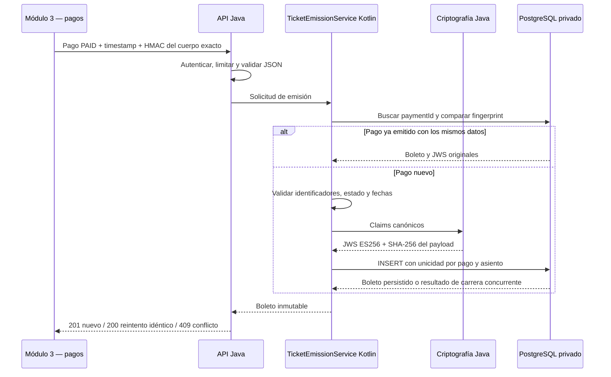

# Arquitectura del Módulo 4

## Responsabilidades del equipo

| Responsable | Entrega |
|---|---|
| Saul Asaph | Contratos REST, límites del módulo e interoperabilidad Java/Kotlin |
| Jonathan Samuel | SHA-256, ECDSA P-256, JWS ES256 y protección de llaves |
| Sunem Gizeht | Dominio, emisión transaccional e idempotencia en Kotlin |
| Ricardo Carmona | Controladores Java, autenticación del webhook y validación HTTP |
| Jeanette Verónica | Consola React, visualización, exportación HTML e inspección JWS |
| Christopher Dominguez | Docker, PostgreSQL, pruebas y verificación integral |

## Límites y flujo



Cada módulo tiene su propia base de datos. Ningún otro módulo recibe acceso al
PostgreSQL del emisor. Módulos 5 y 6 descargan la llave pública por REST y verifican
los tokens con ES256; la verificación criptográfica no requiere consultar la base.

Los controladores no construyen firmas ni ejecutan SQL. El servicio Kotlin
coordina las reglas de emisión y el repositorio Kotlin encapsula JDBC. La
criptografía Java no conoce HTTP, pagos ni transacciones.

## Identidad del boleto y concurrencia

`paymentId` identifica una operación de emisión de un boleto. `ticketId` aparece
como `jti` dentro del JWT. El contrato actual representa un asiento por pago;
un sistema de pagos con múltiples asientos debe acordar identificadores de
operación por boleto antes de integrar, sin reutilizar un mismo `paymentId` con
datos diferentes.

La restricción única de PostgreSQL y la inserción atómica resuelven los reintentos
concurrentes entre instancias del servicio. El fingerprint incluye los datos
normalizados del pago y del evento, y excluye la envoltura de autenticación HTTP.
Una nueva marca temporal HMAC permite reintentar sin cambiar la identidad de la
emisión. Un conflicto por asiento no genera un segundo boleto.

El JWS se genera una vez para la fila ganadora y se devuelve desde almacenamiento
en solicitudes posteriores. No se reconstruye ni se vuelve a firmar. La firma
ECDSA es aleatoria y admite representaciones equivalentes; sus bytes no son una
clave de identidad ni una clave de idempotencia.

## Firma y verificación

El hash de auditoría es `SHA-256(UTF8(payloadJson canónico))`. La firma JWS ES256
protege el encabezado y el payload codificados de acuerdo con RFC 7515/7518:

```text
signingInput = base64url(header) + "." + base64url(payload)
signature = ECDSA-P256-SHA256(signingInput)
token = signingInput + "." + base64url(R || S)
```

`SHA256withECDSA` recibe los bytes del signing input y calcula su hash
internamente. Pasarle un hash precalculado produciría doble SHA-256 y rompería
la interoperabilidad ES256. El perfil canónico, formatos de llave y pruebas
están definidos en [crypto-specification.md](crypto-specification.md).

La aplicación verifica además emisor, audiencia, esquema, estado, identidad y
vigencia. La validación de acceso efectivo, consumo único en puertas, revocación
operativa y QR dinámico corresponden a los módulos 5 y 6. Un QR de demostración
del JWS no sustituye el mecanismo dinámico anticopia del módulo 5.

## Fronteras de confianza

- El emisor confía en el Módulo 3 únicamente después de autenticar el webhook.
  El contrato local utiliza HMAC-SHA256 del cuerpo exacto con una ventana temporal.
  El secreto se distribuye a ese módulo por un canal de configuración seguro.
- Los usuarios finales se autentican en el Módulo 1; el emisor no almacena
  contraseñas de clientes ni implementa pagos. Los contratos de identidad de los
  demás módulos deben mapear sus identificadores al contrato documentado.
- El panel interno utiliza una credencial administrativa aleatoria y rutas
  protegidas. La emisión de demostración requiere además el modo sandbox
  explícito; debe desactivarse en despliegues reales.
- La llave privada reside en un volumen exclusivo de Docker, fuera del contexto
  de compilación y del repositorio. Nunca se devuelve por API.
- La aplicación usa un rol PostgreSQL sin privilegios de administración ni de
  actualización, eliminación o truncado. Los triggers protegen la tabla también
  ante modificaciones SQL normales de un propietario. Un administrador de base
  puede cambiar el esquema: el modelo no pretende resistir a un administrador
  que desactive controles o restaure copias manipuladas.
- HTTP local se expone en loopback. Un despliegue compartido debe terminar TLS
  en el proxy de la plataforma y proteger las credenciales en su gestor de secretos.

## Operación

Se conservan los volúmenes de PostgreSQL y de firma entre reinicios. Un arranque
con llaves ausentes o incompatibles debe fallar; nunca reemplazar silenciosamente
una llave que ya firmó boletos. Respaldar la base y la llave privada por separado
con acceso restringido. La rotación exige conservar y publicar llaves históricas
para los boletos vigentes; no reemplazar archivos para simular una rotación.

Las migraciones se ejecutan con credenciales administrativas en un contenedor
separado. El proceso de aplicación no recibe esa contraseña. Las pruebas usan
otra instancia PostgreSQL temporal para no alterar los boletos de demostración.
